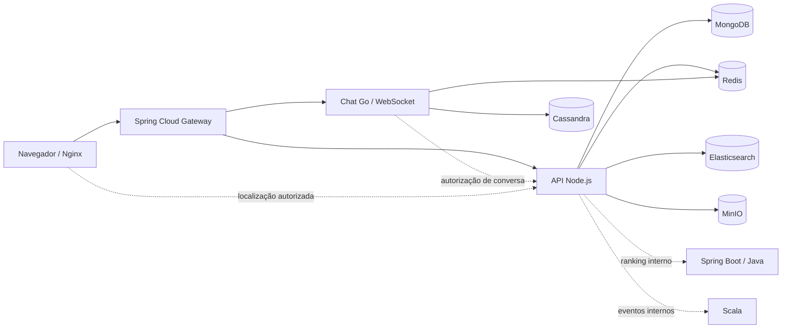

# Arquitetura implementada do WorkerIN

## Fluxo

## Componentes ativos no `docker-compose.yml`

| Componente | Responsabilidade |
| --- | --- |
| Nginx | Serve `index.html`, `styles.css` e `app.js`; encaminha API, histórico de chat e WebSocket. |
| Spring Cloud Gateway | Entrada única para serviços internos, nas rotas `/api/**`, `/chat/**` e `/ws/**`. |
| Node.js / Express | Cadastro e login, perfis freelancer/empresa, projetos, interesses, matches, busca geográfica, geocodificação e URLs de mídia. |
| Go / WebSocket | Chat autenticado com ticket JWT de 60 segundos, checagem de participação, pub/sub Redis, presença e persistência Cassandra. |
| Spring Boot / Java | Serviço interno de ranking combinando competências, distância, tarifa e disponibilidade. |
| Scala 3 | Endpoint interno para contagem de eventos de produto; sem recomendação por IA. |
| MongoDB | Contas, perfis, projetos, interesses, matches e conversas. Inclui índice 2dsphere para fallback geográfico. |
| Redis | Presença e distribuição em tempo real de mensagens entre conexões WebSocket. |
| Cassandra | Histórico de mensagens particionado por conversa e ordenado por horário. |
| Elasticsearch | Índice de descoberta de perfis, filtros e ordenação geográfica; a API retorna ao MongoDB se a busca estiver indisponível. |
| MinIO | Objetos de perfil. A API emite URL assinada de upload; os objetos deste ambiente local são públicos para leitura. |

## Fluxos de produto

1. Cadastro cria uma conta com senha bcrypt e perfil do tipo freelancer ou empresa. Pessoas têm idade mínima de 18 anos; empresas não exibem os campos de gênero/idade.
2. A descoberta aceita tipo de perfil, gênero, área, cidade, modalidade, tarifa máxima, disponibilidade e raio. O navegador pode solicitar coordenadas; os cartões mostram apenas distância aproximada.
3. Interesses ficam no MongoDB. Interesses recíprocos criam uma conexão e uma conversa.
4. Ao abrir uma conversa, a API cria um ticket de chat curto. O serviço Go valida o ticket e confirma participação com um endpoint interno autenticado. Mensagens são publicadas pelo Redis e persistidas em Cassandra.
5. O perfil admite imagem, vídeo curto ou GIF de apresentação. A API retorna URLs assinadas em `POST /api/media/upload-url` e o perfil guarda somente os metadados/URLs.
6. No modo local, `POST /api/lives` inicia uma transmissão autenticada. `GET /api/lives` lista sessões ativas e um ticket de curta duração em `POST /api/auth/live-ticket` libera a sinalização em `/ws/live`. O navegador estabelece áudio e vídeo diretamente entre host e espectadores por WebRTC; não há gravação nem servidor TURN/SFU configurado.
7. Free pode curtir perfis e conversa após interesse mútuo. Pro (R$ 7/mês) pode consultar `GET /api/account/activity` para curtidas e visitas e iniciar conversas sem match em `POST /api/conversations/direct/:profileId`. A API verifica a assinatura em todas essas rotas. A visita é registrada ao abrir o perfil detalhado, com deduplicação de 24 horas por visitante/perfil.
8. O ranking Java está disponível internamente em `POST /api/internal/profiles/rank`; eventos Scala em `/internal/analytics/events`. O endpoint de ranking não é chamada automaticamente pela descoberta nesta primeira integração.

## Rotas da API Node

- `POST /api/auth/register`, `POST /api/auth/login`, `POST /api/auth/ws-ticket`
- Modo local: `POST /api/auth/live-ticket`, `GET/POST /api/lives`, `DELETE /api/lives/:id`, WebSocket `/ws/live`
- Plano: `GET /api/account/plan`, `GET /api/account/activity`, `POST /api/subscriptions/checkout`, `POST /api/conversations/direct/:profileId`
- `GET /api/profiles/discover`, `GET /api/profiles/me`, `GET /api/profiles/:id`, `PATCH /api/profiles/me`
- `POST /api/profiles/:targetId/interests`, `POST /api/profiles/:targetId/pass`
- `GET/POST /api/projects`, `GET /api/matches`, `GET /api/conversations`
- `POST /api/media/upload-url`, `GET /api/location/geocode`
- `GET /api/health/live`, `GET /api/health/ready`

## Segurança e limites deste ambiente

JWT e token entre serviços devem ter ao menos 32 caracteres. `.env` não é versionado; `.env.example` tem apenas valores de referência. Em produção, trocar segredos, restringir origens CORS, proteger mídia privada e redes/portas, habilitar TLS, autenticação dos bancos, backup/retention e moderação. Redis/Mongo/Cassandra/Elasticsearch não expõem portas no host neste Compose. Geolocalização do browser precisa de HTTPS fora do localhost. O ambiente local não configura Google Maps/Mapbox por padrão.

IA foi explicitamente deixada fora do escopo. A transmissão WebRTC funciona no modo local enquanto o host mantém a sessão ativa. A mídia trafega diretamente entre participantes; redes com NAT restritivo precisam de TURN, e o stack distribuído ainda não possui retransmissão SFU.

O plano Pro exibe o preço de R$ 7 por mês, mas não há provedor de pagamento conectado neste ambiente. `POST /api/subscriptions/checkout` responde indisponível e nenhuma assinatura paga pode ser criada até a configuração do checkout e webhook do provedor.

## Execução imediata sem Docker

`npm run dev` inicia `services/api-node/src/demo-server.js` em `http://localhost:4173`. Esse modo usa o mesmo frontend, cadastro, endpoints, interesses, matches, projetos, upload local e WebSocket, com persistência JSON em `data/local-demo.json`; mídias ficam em `data/uploads/`. Não expõe a pasta do projeto como conteúdo estático. Ele serve para desenvolvimento e demonstração local, sem substituir a persistência e a escala dos serviços distribuídos listados acima.
